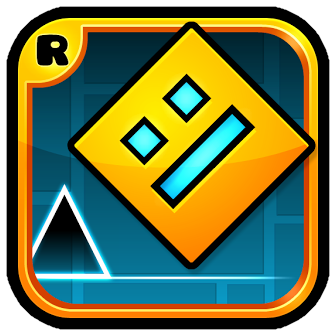

#input-buffering
What is it?
It's an experimental mod for Geometry Dash, developed with Geode, that temporarily holds the player's inputs (press and release of the jump button) before applying them to the game. Its purpose is to explore the concept of input buffering described in the reference video, although its current implementation is a didactic approximation, not a functional replica of the original mod.

In simple terms: it's a mod that delays your clicks N ticks before applying them, instead of executing them instantly.

What does it do exactly?
When the player presses or releases the jump button, the mod does not execute the action immediately. Instead:

It saves the player's intent in an internal flag (pendingJump or pendingRelease).

It accumulates ticks on each physics step while waiting.

It applies the input after N ticks, without checking whether that moment is safe or not.

The behavior varies depending on the game mode:

Cube: holds the press until the player touches the ground (m_isOnGround == true). If the player clicks in the air, the jump executes upon landing. This replicates GD's native hold-to-jump, it doesn't improve it.

Wave, Ship, UFO, Ball, Robot, Spider: holds both press and release for exactly N ticks before applying them, with no additional condition.

How is it controlled?
F6 key: cycles through the mod's stages.

Off: vanilla behavior, no holding.

2t: holds 2 ticks.

4t: holds 4 ticks.

8t: holds 8 ticks.

On-screen overlay: displays Dynamic[stage] saved:N last:action, where saved indicates how many ticks accumulated before the last input was applied, and last indicates which action was applied (jump, hold, release).

Which game modes does it work in?
Mode	Behavior	Effectiveness
Cube	Waits for ground to jump	None: replicates vanilla hold-to-jump
Wave (press)	Fixed N-tick delay	Very limited: only works if you click exactly N ticks early
Wave (release)	Fixed N-tick delay	Partial: this is the only thing that comes close to the video's behavior
Ship, UFO, Ball, Robot, Spider	Fixed N-tick delay	Very limited: same limitation as wave press
What does it NOT do?
It's important to be clear about the limitations:

❌ It does not simulate the game's physics: it doesn't calculate future positions or velocities.

❌ It does not check collisions: it doesn't know whether the pending input will save the player or kill them.

❌ It does not choose the correct tick: it applies the input N ticks later, without evaluating whether it's safe.

❌ It does not forgive late clicks: if you click at the correct moment or late, you die.

❌ It does not forgive arbitrary early clicks: it only works if you click exactly N ticks early, not "any click within the window".

❌ It does not improve cube: cube behavior is equivalent to vanilla.

How does it work technically?
The mod hooks into three game functions via Geode:

PlayerObject::pushButton: intercepts the jump button press. If the mod is active, it saves the intent instead of executing it.

PlayerObject::releaseButton: intercepts the release. Same behavior: saves the intent if the mod is active.

PlayerObject::update: on each physics tick, increments the counters and applies the input when the N limit is reached (or when the player touches the ground, in the case of cube).

Additionally, a fourth hook in CCKeyboardDispatcher::dispatchKeyboardMSG detects the F6 key to cycle stages, and a fifth hook in PlayLayer::init creates the visual overlay.

What is it useful for, then?
For three specific things:

Didactic purposes: understanding how to structure an input buffer in Geode (hooks, global state, overlay, control keys).

Conceptual testing: experimentally measuring the effect of a fixed N-tick delay across different modes and timings.

Starting point: it serves as a base on which to add physics simulation and collision detection to get closer to the video's mod.

Why is it controversial?
Although its implementation is limited, the mod does illustrate the problem that the video denounces:

With 2 ticks, the delay is small enough that certain difficult clicks pass more consistently if the player learns to click exactly 2 ticks early.

The interface (F6, overlay, stages) replicates the original mod's.

Its existence demonstrates how easy it is to build an assistance tool without prior programming experience, using AI and public APIs like Geode.



*Update logo.png to change your mod's icon (please)*

## Getting started
We recommend heading over to [the getting started section on our docs](https://docs.geode-sdk.org/getting-started/) for useful info on what to do next.

## Build instructions
For more info, see [our docs](https://docs.geode-sdk.org/getting-started/create-mod#build)
```sh
# Assuming you have the Geode CLI set up already
geode build
```

# Resources
* [Geode SDK Documentation](https://docs.geode-sdk.org/)
* [Geode SDK Source Code](https://github.com/geode-sdk/geode/)
* [Geode CLI](https://github.com/geode-sdk/cli)
* [Bindings](https://github.com/geode-sdk/bindings/)
* [Dev Tools](https://github.com/geode-sdk/DevTools)
